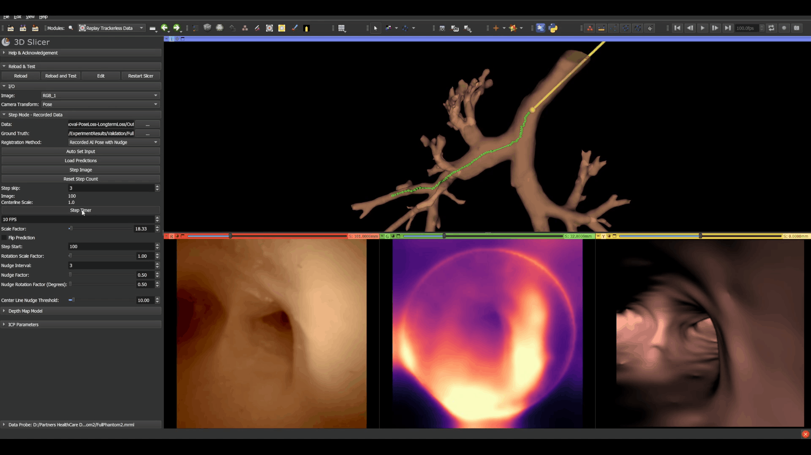

# Trackerless Bronchoscopic Navigation

A collection of 3D Slicer tools used in the research for
[Self-supervised direct pose estimation for vision-based tracking in navigated bronchoscopy](https://doi.org/10.1016/j.compbiomed.2025.110958)
(Kalia et al., 2025). They cover recording bronchoscopy data, generating depth
maps, replaying recorded and pose-estimated data in 3D Slicer, and analyzing the
resulting trajectories against ground truth.

## Modules

| Module | What it does |
|---|---|
| **Endoscope Record** | Records bronchoscope video frames (RGB, grayscale, depth) together with catheter and target transforms. |
| **Replay Trackerless Data** | Replays recorded bronchoscopy data and pose-estimated results step by step in 3D Slicer. Can also estimate the bronchoscope pose by registering predicted depth maps to the airway model with ICP, with centerline "nudging" to keep the estimate inside the airway, and automation for batch runs. |
| **Depth Map Generation** | Renders depth maps and matching RGB images from a virtual camera inside an airway model, for example to create training or ground-truth data. |
| **Depth Map Reform** | Converts a depth map back into 3D geometry from a camera's position. |
| **Modified Centerline Computation** | A modified version of the centerline computation module from SlicerVMTK, used to extract the airway centerline (Apache 2.0, see its [LICENSE.txt](ModifiedCenterlineComputation/LICENSE.txt)). |
| **Separate Branches** | Splits an airway centerline into named branches. |
| **Trajectory Analysis** | Compares estimated bronchoscope trajectories with ground truth: distance errors and branch-label agreement. |

## Requirements

- 3D Slicer 5.0.2
- Extensions (install from the Extensions Manager): SlicerVMTK, SlicerIGT
- Python packages: PyTorch, OpenCV (`opencv-python`), SciPy, Pillow
- OS: Windows

## Installation

1. Download or clone this repository.
2. In 3D Slicer, open **Edit > Application Settings > Modules** and add each
   module folder (for example `ReplayTrackerlessData`) to **Additional module paths**.
3. Restart 3D Slicer. The modules appear under the **Navigation** and
   **Utilities** categories.

## Citation

M. Kalia, F. King, F. Masaki, N. Hata. "Self-supervised direct pose estimation
for vision-based tracking in navigated bronchoscopy." *Computers in Biology and
Medicine* 197 (2025): 110958. https://doi.org/10.1016/j.compbiomed.2025.110958

## License

Distributed under the 3D Slicer license, a BSD-style license. See
[License.txt](License.txt).
